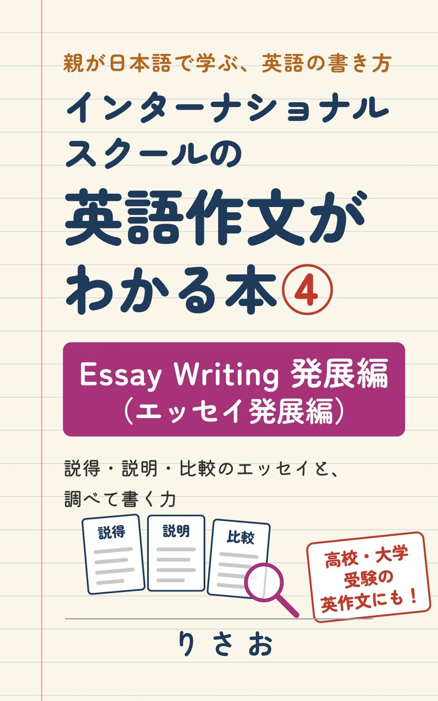

# Kindle本：インターナショナルスクールの英語作文がわかる本④ — Essay Writing 発展編（エッセイ発展編）

**発売中です（2026年11月28日発売）。** [Amazon の商品ページ](https://www.amazon.co.jp/dp/ASIN_TBD)

- **書名**：インターナショナルスクールの英語作文がわかる本④　Essay Writing 発展編（エッセイ発展編）　親が日本語で学ぶ、説得・説明・比較のエッセイと、調べて書く力
- **著者**：りさお
- **形式**：Kindle本（Kindle Unlimited でも読めます）。紙の本（ペーパーバック）も準備しています
- **価格**：[Amazon の商品ページ](https://www.amazon.co.jp/dp/ASIN_TBD)でご確認ください
- **シリーズ**：第1巻は [Narrative Writing（物語文）編](narrative-writing.md)、第2巻は [Opinion Writing（意見文）編](opinion-writing.md)、第3巻は [Essay Writing 基本編（エッセイ基本編）](essay-writing.md)

## どんな本？

インターナショナルスクールでは、小学5〜6年生ごろになると、エッセイの課題が一段むずかしくなります。課題文の言葉が「説得しましょう（*persuade*）」「説明しましょう（*explain*）」「比べましょう（*compare*）」と増え、理科や社会の調べ学習でも、本やサイトで調べたことをエッセイの形でまとめるようになります。

この本では、エッセイの3つの目的（説得する・説明する・比べる）を見分けて書き分ける方法と、資料から根拠を集め、自分の言葉でまとめ、出典を書く方法を、保護者が日本語で学べるようにまとめました。最後に、問いを立てるところから発表まで、調べて書くエッセイを親子で1本仕上げます。英語の課題の言葉や例文はそのまま英語で載せ、日本語訳と解説をつけています。

## 対象の読者

- 英語で教育を受けている、おおむね10〜12歳の子どもの保護者（インターナショナルスクール、英語イマージョン校、海外の現地校など）
- 5段落のエッセイは書けるようになったけれど、目的に合わせた書き分けや、調べ学習のエッセイで手が止まる子どもを支えたい方
- 出典の書き方や、AI との付き合い方を、家庭でどう伝えればよいか迷っている方

第1章で、エッセイの形と段落の型 PEEL を短くふり返るので、この本から読み始めることもできます。

## 本で学べること

- 課題文の言葉から、エッセイの目的（説得・説明・比較）を見分ける方法
- 説得するエッセイ：読み手を決めて、強い理由と言葉を選ぶ。反対の意見に答える段落
- 説明するエッセイ：しくみ・順序・原因と結果・問題と解決の組み立て
- 比べるエッセイ：ベン図と比べる表、2つの組み立て、同じ点とちがう点を表す言葉
- 資料を選び、2列のメモを取り、要約する方法
- 言い換えと短い引用で、資料の事実を段落の根拠に入れる方法、数字や表の使い方
- 出典（*Sources*）の書き方と、AI を正しく使うための家庭のルール
- 調べて書くエッセイを1本仕上げる進め方、根拠と出典を見る添削、推敲・発表・振り返り

## 目次

| 部 | 章 | タイトル |
|---|---|---|
| 第I部　目的に合わせて書き分ける | 第1章 | エッセイの3つの目的：同じ題材を、説得・説明・比較で書き分ける |
| | 第2章 | 説得するエッセイ：読み手を決め、強い理由と言葉を選ぶ |
| | 第3章 | 反対の意見に答える段落（発展） |
| | 第4章 | 説明するエッセイ：しくみ・順序・原因と結果 |
| | 第5章 | 比べるエッセイ：同じ点とちがう点 |
| 第II部　調べて書く | 第6章 | 資料を選び、メモを取り、要約する |
| | 第7章 | 言い換えと短い引用：資料のことばを、PEEL の根拠に入れる |
| | 第8章 | 出典を書く、AI を正しく使う |
| 第III部　家庭での実践 | 第9章 | 調べて書くエッセイを1本仕上げる：問いから提出まで |
| | 第10章 | 子どもの考えを生かす添削とフィードバック：根拠と出典を見る |
| | 第11章 | 推敲・発表・振り返り：調べたことを発表する |

各章に、そのまま使える英語の声かけ（日本語訳つき）と避けたい声かけ、「今日のお題」で取り組む親子で試す15分間の練習（レベル1〜3、答えの例つき）があります。付録には、語彙集、同じ題材で書いた3つの模範エッセイ、添削前後の例、保護者用チェックリスト、計画シート、1日15分×11回の学習プラン、参考資料、用語集を入れています。

## 本の読者の方へ：印刷用シート

本に出てくる2列のメモ、比べる表、説得・説明の計画シート、推敲のチェックリストは、[読者用ページ](https://adash333.github.io/books/essay-advanced/)から、A4 の PDF（空欄と記入例）をダウンロードできます。

## このサイトで読めること

PEEL、OREO など段落の型の一覧は、[Writing の分類](../writing/taxonomy.md)にまとめています。エッセイの基本（PEEL から5段落エッセイまで）は、第3巻の [Essay Writing 基本編](essay-writing.md)で紹介しています。

[← トップページに戻る](../README.md)
