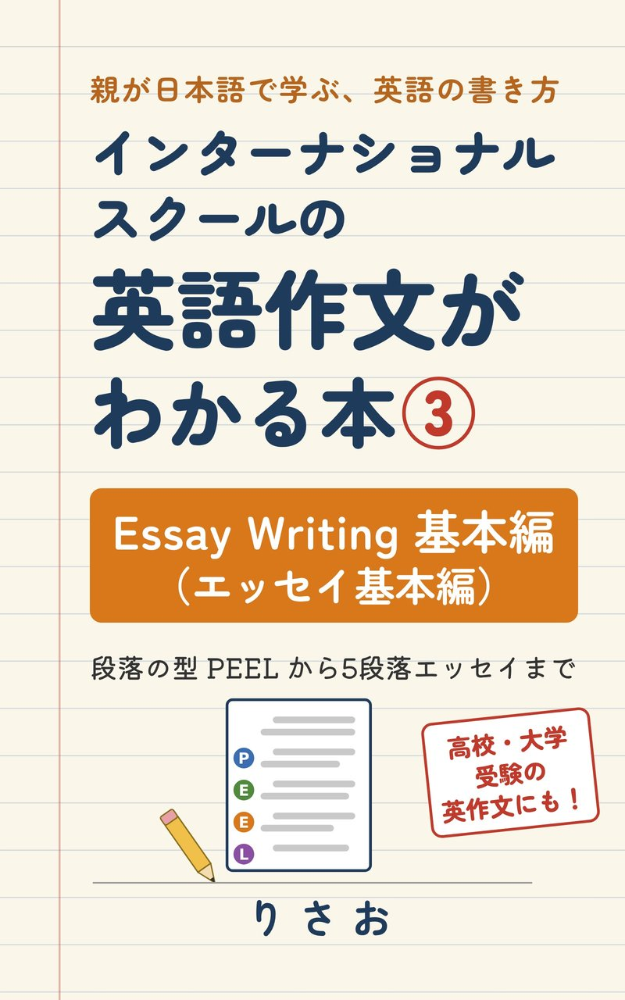

# Kindle本：インターナショナルスクールの英語作文がわかる本③ — Essay Writing 基本編（エッセイ基本編）

**発売中です（2026年11月25日発売）。** [Amazon の商品ページ](https://www.amazon.co.jp/dp/B0H1973XG7)

- **書名**：インターナショナルスクールの英語作文がわかる本③　Essay Writing 基本編（エッセイ基本編）　親が日本語で学ぶ、段落の型 PEEL から5段落エッセイまでの書き方と家庭での支え方
- **著者**：りさお
- **形式**：Kindle本（Kindle Unlimited でも読めます）。紙の本（ペーパーバック）も準備しています
- **価格**：[Amazon の商品ページ](https://www.amazon.co.jp/dp/B0H1973XG7)でご確認ください
- **シリーズ**：第1巻は [Narrative Writing（物語文）編](narrative-writing.md)、第2巻は [Opinion Writing（意見文）編](opinion-writing.md)、第4巻は [Essay Writing 発展編（エッセイ発展編）](essay-writing-advanced.md)

## どんな本？

インターナショナルスクールでは、小学4〜6年生ごろになると、段落をいくつも重ねて考えを書く宿題が増えていきます。アメリカ式の学校では「エッセイ（*essay*）」、イギリス式の学校では「説得文（*persuasive writing*）」や「議論文（*balanced argument*）」などと呼ばれる課題です。

英語圏の学校の *essay* は、問いに答えて、自分の考えを、段落を重ねて筋道立てて伝える文章です。この本では、段落の型 PEEL（主張 → 根拠 → 説明 → つなぎ）で1つの段落をしっかり書くところから始めて、主張の文、書き出し、結論を加え、5段落のエッセイを親子で1本書きあげるまでを、保護者が日本語で学べるようにまとめました。英語の課題の言葉や例文はそのまま英語で載せ、日本語訳と解説をつけています。

## 対象の読者

- 英語で教育を受けている、おおむね9〜11歳の子どもの保護者（インターナショナルスクール、英語イマージョン校、海外の現地校など）
- 子どもに英語の作文を教える先生
- 段落を組み立てて英語で考えを書く方法を、学び直したい大人

各章の練習はレベル1〜3に分かれているので、学年よりも、子どもの今の力に合わせて選べます。

## 本で学べること

- エッセイの3つの部分（書き出し・本文・結論）と5つの段落、課題文（*prompt*）とルーブリック（評価表）の読み方
- PEEL：1つの段落に1つの話を書く型と、段落の最初の1文（トピックセンテンス）
- 根拠の4つの種類（事実・数字・例・体験）と、「だから何？（*So what?*）」に答える説明
- 主張の文（*thesis statement*）と3つの柱、書き出しの段落と結論の段落
- アウトラインと、段落どうしをつなぐことば
- 見本を読む → 一緒に書く → 自分で書く、の3段階、子どもの考えを生かす添削、推敲・発表・振り返り

## 目次

| 部 | 章 | タイトル |
|---|---|---|
| 第I部　エッセイの全体像 | 第1章 | エッセイとは何か：段落を重ねて考えを伝える文章 |
| | 第2章 | 課題文の言葉とルーブリックの読み方 |
| 第II部　段落を組み立てる | 第3章 | PEEL：1つの段落に1つの話 |
| | 第4章 | 根拠を選ぶ：事実・数字・例・体験 |
| | 第5章 | 説明を書く：「だから何？」に答える |
| 第III部　5段落エッセイを組み立てる | 第6章 | 主張の文と3つの柱 |
| | 第7章 | 書き出しの段落：つかみ→背景→主張 |
| | 第8章 | 結論の段落：まとめと、読み手への一言 |
| | 第9章 | アウトラインで組み立てる：段落どうしのつなぎと、5段落の先へ |
| 第IV部　家庭での実践 | 第10章 | 見本を読む→一緒に書く→自分で書く |
| | 第11章 | 子どもの考えを生かす添削とフィードバック：組み立てを見る |
| | 第12章 | 推敲・発表・振り返り |

各章に、そのまま使える英語の声かけ（日本語訳つき）と避けたい声かけ、「今日のお題」で取り組む親子で試す15分間の練習（レベル1〜3、答えの例つき）があります。付録には、課題によく出る英語の語彙集、3段階の模範エッセイ、添削前後の例、保護者用チェックリスト、計画シート、1日15分×12回の学習プラン、参考資料、用語集を入れています。

## このサイトで読めること

PEEL、OREO など段落の型の一覧は、[Writing の分類](../writing/taxonomy.md)にまとめています。意見文の型は第2巻の [Opinion Writing（意見文）編](opinion-writing.md)で紹介しています。

[← トップページに戻る](../README.md)
