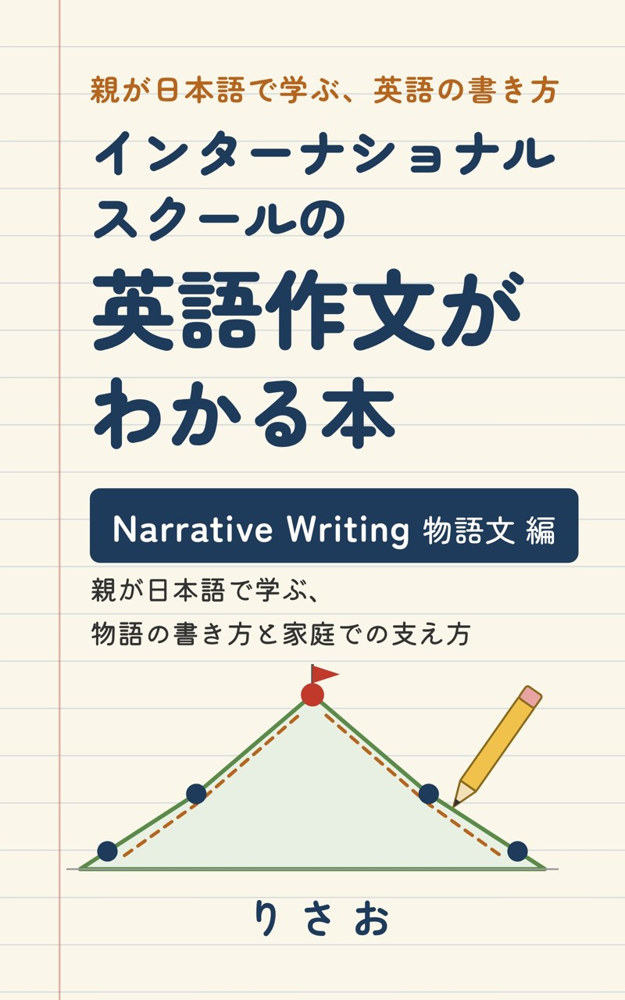

# Kindle本：インターナショナルスクールの英語作文がわかる本 — Narrative Writing（物語文）編

**発売中です（2026年11月8日発売）。** [Amazon の商品ページ](https://www.amazon.co.jp/dp/B0HQY24QD6)

- **書名**：インターナショナルスクールの英語作文がわかる本　Narrative Writing（物語文）編　親が日本語で学ぶ、物語の書き方と家庭での支え方
- **著者**：りさお
- **形式**：Kindle本（Kindle Unlimited でも読めます）
- **価格**：[Amazon の商品ページ](https://www.amazon.co.jp/dp/B0HQY24QD6)でご確認ください

## どんな本？

英語圏の学校で、小学校の早い段階から学ぶ「物語を書く文章（*Narrative Writing*）」の書き方と教え方を、日本語で学べる本です。英語の課題の言葉や例文はそのまま英語で載せ、日本語で解説します。

## 対象の読者

- 英語で教育を受けている、おおむね6〜9歳の子どもの保護者（インターナショナルスクール、IB校など）
- 子どもに英語の作文を教える先生
- 英語の作文の「型」を学び直したい大人

学年よりも、英語の習熟度に合わせて使えるように書いています。

## 本で学べること

- 学校の Writing の課題と、評価表（ルーブリック）の読み方
- *Who / Where / What happened* から始める、最初の物語
- *Beginning / Middle / End*、*Story Mountain* で物語を組み立てる方法
- 登場人物・場所・問題と解決、順序の言葉、動詞・描写・会話
- 子どもの文章を奪わない声かけと添削、推敲・発表・振り返り

## 目次

全13章を、階段を1段ずつ上るように進めます。

| 章 | 内容 |
|---|---|
| 第1章 | 英語圏の学校で学ぶ文章の型の全体像（アメリカ・イギリス・オーストラリア・IB）と、型を学ぶ意義 |
| 第2〜5章 | 物語の基本：課題文とルーブリックの読み方、*Who / Where / What happened*、*Beginning / Middle / End* |
| 第6〜10章 | 物語を育てる：登場人物と舞台、困ったことと解決、順序の言葉、動詞・描写・セリフ、*Story Mountain* |
| 第11〜13章 | 家庭で1本の物語を書き上げる：見本を読む→一緒に書く→自分で書く、添削とフィードバック、推敲・発表・振り返り |

付録には、課題によく出る英語の語彙集、レベル別の模範作品、保護者用チェックリスト、1日15分×12回の学習プラン、全章の練習の解答例を入れています。

発売のお知らせと、ブログの連載との違いは、[ブログ記事「Kindle本を出版しました」](https://risan.jpn.org/?p=17245)にまとめています。

## このサイトで読めること

物語文以外の文章の種類と段落の型は、[Writing の分類](../writing/taxonomy.md)にまとめています。物語を書いたあとの発表の練習には、[Show & Tell](../lessons/presentation/show-and-tell.md) が使えます。

[← トップページに戻る](../README.md)
