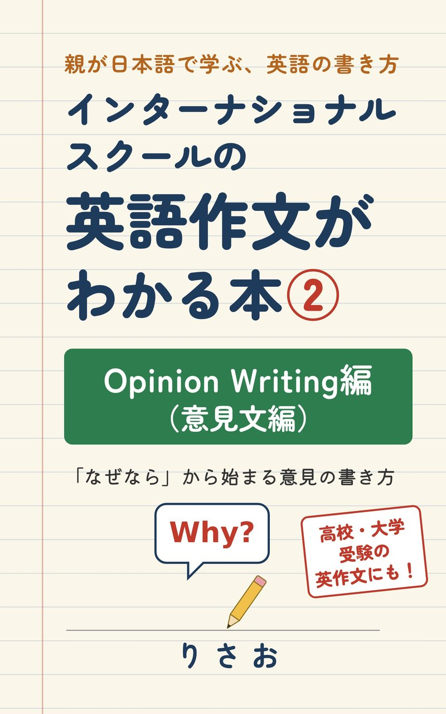

# Kindle本：インターナショナルスクールの英語作文がわかる本② — Opinion Writing編（意見文編）

**発売中です（2026年11月13日発売）。** [Amazon の商品ページ](https://www.amazon.co.jp/dp/B0HRJ8JMYK)

- **書名**：インターナショナルスクールの英語作文がわかる本②　Opinion Writing編（意見文編）　親が日本語で学ぶ、「なぜなら」から始まる意見の書き方と家庭での支え方
- **著者**：りさお
- **形式**：Kindle本（Kindle Unlimited でも読めます）
- **価格**：[Amazon の商品ページ](https://www.amazon.co.jp/dp/B0HRJ8JMYK)でご確認ください
- **シリーズ**：第1巻は [Narrative Writing（物語文）編](narrative-writing.md)

## どんな本？

英語圏の学校で、小学校の早い段階から書く「意見文（*Opinion Writing*）」の書き方と、家庭での支え方を、保護者が日本語で学べる本です。*I think … because …*（…だと思います。なぜなら…）の1文から始めて、理由・例・締めくくりのある文章まで、親子で一段ずつ進めます。英語の課題の言葉や例文はそのまま英語で載せ、日本語訳と解説をつけています。

意見に正解はありません。この本では、子どもが自分で決めた意見と理由が、読み手に伝わるように書けることを目指します。

## 対象の読者

- 英語で教育を受けている、おおむね6〜9歳の子どもの保護者（インターナショナルスクール、英語イマージョン校、海外の現地校など）
- 子どもに英語の作文を教える先生
- 英語で意見を筋道立てて書く方法を、学び直したい大人

各章の練習はレベル1〜3に分かれているので、学年よりも、子どもの今の力に合わせて選べます。

## 本で学べること

- 意見文とは何か、学校の課題とルーブリック（評価表）の読み方
- *I think … because …* の1文から、理由を2つ、3つに増やす方法
- OREO（意見→理由→例→意見）の型、例で理由を支える方法、つなぎの言葉、締めくくりの文
- 読み手を思い浮かべて書くことと、意見文の計画シート
- 子どもの意見を生かす声かけと添削、推敲・発表・振り返り

## 目次

| 章 | タイトル |
|---|---|
| 第1章 | 意見文とは何か |
| 第2章 | 学校の課題とルーブリックの読み方 |
| 第3章 | *I think … because …*：最初の1文 |
| 第4章 | 理由を2つ、3つに増やす |
| 第5章 | OREO：意見→理由→例→意見 |
| 第6章 | 例で理由を支える |
| 第7章 | つなぎの言葉 |
| 第8章 | 締めくくりの文：意見をもう一度、別の言葉で |
| 第9章 | 読み手を思い浮かべる |
| 第10章 | 意見文の計画シート（発展） |
| 第11章 | 見本を読む→一緒に書く→自分で書く |
| 第12章 | 子どもの意見を奪わない添削とフィードバック |
| 第13章 | 推敲・発表・振り返り |

各章に、おすすめの声かけと避けたい声かけ、親子で試す15分間の練習（レベル1〜3）があります。付録には、課題によく出る英語の語彙集、3段階の模範作品、添削前後の例、保護者用チェックリスト、1日15分×12回の学習プラン、参考資料、全章の練習の解答例を入れています。

## ブログの記事

発売のお知らせと、意見文の基本は、ブログ「東大理三夫婦のこそだて」の連載【英語ライティング】で読めます。

- [【英語ライティング#6】英語の意見文、親はどう手伝う？（発売のお知らせ）](https://risan.jpn.org/?p=17267)：本を書いたきっかけと、本でわかること
- [【英語ライティング#7】英語の「意見文」とは？ opinion・persuasive・argument のちがいと、米・英・豪・IBで学ぶこと](https://risan.jpn.org/?p=17268)：意見文の呼び名のちがいと、各国の学校で学ぶこと

## このサイトで読めること

OREO、PEEL など段落の型の一覧は、[Writing の分類](../writing/taxonomy.md)にまとめています。シリーズの次の巻は、[Essay Writing 基本編（エッセイ基本編）](essay-writing.md)です。

[← トップページに戻る](../README.md)
